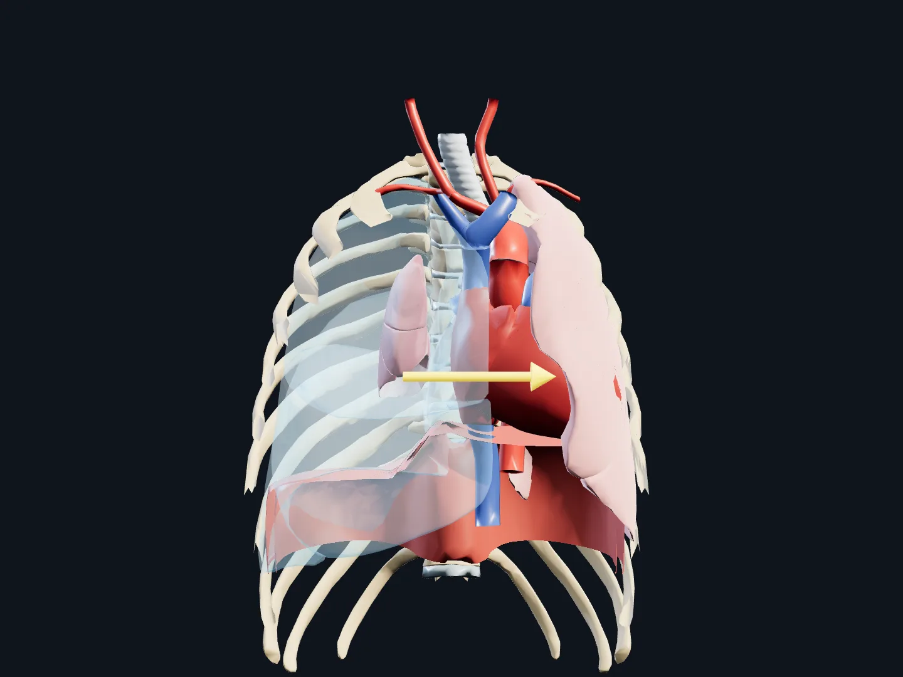

# Sagittal

Medical image generation: Sagittal is an open-source static website of labelled,
interactive three.js anatomy figures for medical students, with Anki decks built
from the same scenes. Phase 1 is a premade library of scenes served as plain
static files, with no server.

**Review status:** every visual is currently marked "Unreviewed: verify
against your textbook". Do not treat any scene as authoritative.

**Educational use only.** sagittal is not clinical advice and must not be used
for diagnosis or treatment decisions.

**Live site:** `https://<your-github-user>.github.io/sagittal/` (placeholder:
replace with the real URL once the repository is published).

## Run locally

    npm ci
    python3 -m http.server 8000 --directory site

Open http://localhost:8000/. The "Download Anki decks" links on the gallery
point at `decks/`, which only exists on the deployed site (CI copies the built
decks there), so they 404 when serving `site/` locally.

## Build cards and Anki decks

    python3 -m venv .venv && .venv/bin/pip install -r tools/requirements.txt
    npm run cards       # PNGs into build/cards (needs Google Chrome locally)
    npm run decks       # 2D decks into build/decks/sagittal-<topic>.apkg
    npm run decks:3d    # experimental 3D decks, sagittal-<topic>-3d.apkg
    npm run thumbs      # plate images for the landing page into site/thumbs/ (committed)

Re-run `npm run thumbs` after adding or changing a scene (or `node tools/render_thumbs.mjs <id>`
for one). A scene without a thumbnail still shows on the landing page as a plain text plate,
and CI re-renders all thumbnails before deploying.

Decks are downloadable from the live site and attached to GitHub Releases for
`v*` tags.

**Deploying:** `.github/workflows/pages.yml` builds and publishes the site on every push to
`main`. Before the first deploy, set the repository's Settings > Pages > Build and deployment >
Source to **GitHub Actions** (the workflow does not create the Pages site itself).

Every card carries a credit line for the 3D models it shows (each deck's description lists them
too), and every card front shows the review status.

**Anki 3D compatibility:** the 3D deck is experimental. Interactive 3D cards
were confirmed working on Anki desktop by an early spike with a test card.
Phone and tablet clients (AnkiMobile, AnkiDroid) are unverified. The default
2D decks use static images and work everywhere.

## Development

    npm test            # unit tests
    npm run test:py     # Python deck tests
    npm run e2e         # Playwright browser tests

See `CONTRIBUTING.md` for adding scenes and the review process.

Scenes can build on real open anatomical meshes (Z-Anatomy / BodyParts3D, CC BY-SA),
baked into `site/meshes/` by `tools/meshes/bake.py`. See `docs/meshes.md` for the format,
the `Kit.meshPart` / `Kit.tissue` API and the licence rule, and `site/meshes/CREDITS.md`
for attributions.

## Generating new scenes with Claude

`skills/sagittal-scene/SKILL.md` is a Claude Code skill that teaches an AI coding agent to build a
new scene the way the library's scenes were built: choose the view, source real meshes
(baked meshes, Z-Anatomy, or an open CT segmentation via `tools/meshes/ct_to_obj.py`), bake,
write the scene and meta, render the cards and check them by eye, then test. To use it in
Claude Code, copy or symlink the folder into `.claude/skills/` (for example
`mkdir -p .claude/skills && ln -s ../../skills/sagittal-scene .claude/skills/sagittal-scene`).

## Licenses

- Code: MIT (see `LICENSE`).
- Scene content (text, metadata, claims): CC BY-SA 4.0 (see `LICENSE-CONTENT.md`).
- Baked anatomical meshes (`site/meshes/*.js`): licence of their source, CC BY-SA 4.0 for
  Z-Anatomy-derived meshes, CC BY 4.0 for the Rodero heart (see `site/meshes/CREDITS.md`).
- Anatomical coordinate data embedded in scene scripts (for example the Z-Anatomy centre lines
  in `site/scenes/heart.js`, `cor.js`, `bil.js`, `plexus.js`, `portal.js` and `thyroid.js`) keeps
  its source's licence, CC BY-SA 4.0, although the scene code around it is MIT.
- Rendered card images, thumbnails and Anki decks are adaptations of those meshes and are
  shared under CC BY-SA 4.0 with the attribution printed on each card.
